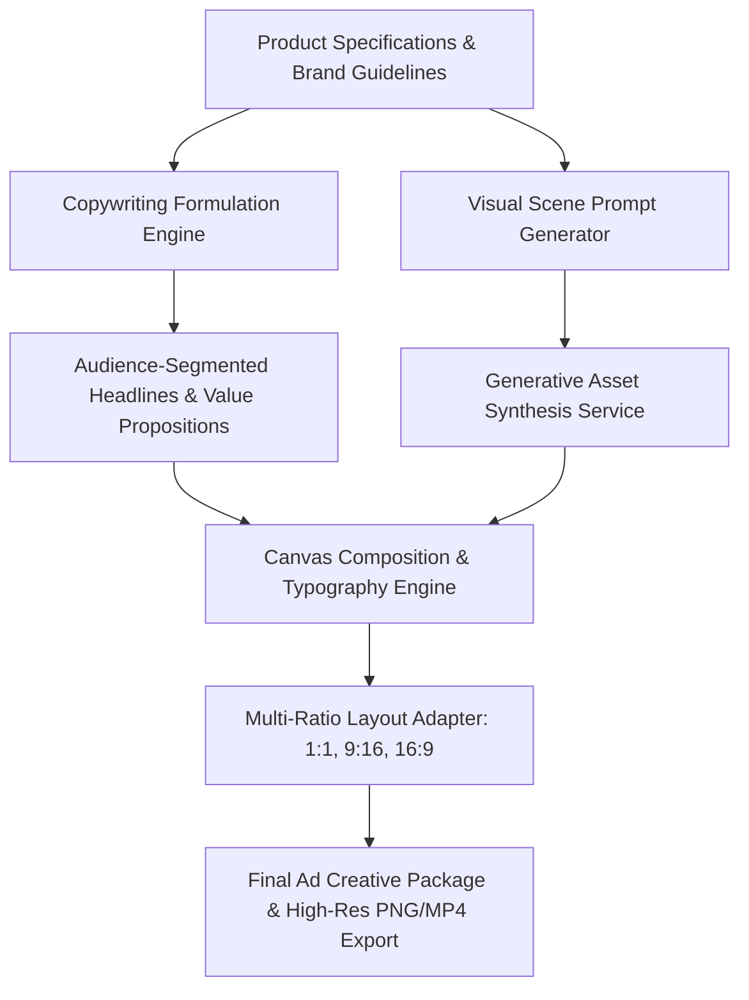

<div align="center">

<h1>Generative Advertisement Creation Pipeline</h1>


<p><strong>Generative System for Automated Ad Copywriting, Visual Synthesis, and Format Adaptation</strong></p>

<p>
  <a href="https://skillicons.dev"></a>
</p>

</div>

---

## Executive Summary

AI Ads Maker is an automated marketing generation platform that transforms basic product inputs into structured, multi-channel advertising creatives. By coupling high-converting marketing copywriting templates with generative asset synthesis, the application generates targeted copy variants, product visuals, and formatted layouts across major advertising channels.

---

## Creative Studio Interface & Ad Output Gallery

<table align="center">
  <tr>
    <td align="center"><b>Campaign Ingestion Studio</b><br><sub>Product description, audience targeting, and tone configuration.</sub></td>
    <td align="center"><b>Generative Copy & Visual Matrix</b><br><sub>Dynamic headline variants paired with synthesized product layouts.</sub></td>
  </tr>
  <tr>
    <td align="center"></td>
    <td align="center"></td>
  </tr>
  <tr>
    <td align="center"><b>Multi-Platform Preview Canvas</b><br><sub>Visual inspection of 1:1, 9:16, and 16:9 responsive ad formats.</sub></td>
    <td align="center"><b>Asset Export & Production Package</b><br><sub>One-click batch asset export ready for ad platform deployment.</sub></td>
  </tr>
  <tr>
    <td align="center"></td>
    <td align="center"></td>
  </tr>
</table>

---

## System Architecture



---

## Technology Stack

| Layer | Technologies |
| :--- | :--- |
| Frontend | React, TypeScript, Vite, Tailwind CSS |
| Backend Server | FastAPI, Python 3.10+, Uvicorn |
| Image Processing | Pillow, OpenCV |
| APIs | RESTful JSON Endpoints |

---

## Installation & Setup

```bash
# Clone the repository
git clone https://github.com/sohailahmed-bsrh/ai-ads-maker.git
cd ai-ads-maker

# Start backend
cd backend
pip install -r requirements.txt
python main.py

# Start frontend
cd ../frontend
npm install
npm run dev
```

---

## Author & License

- **Author**: Sohail Ahmed ([Portfolio](https://sohail.devsil.com) | [GitHub](https://github.com/sohailahmed-bsrh))
- **License**: Distributed under the MIT License.
