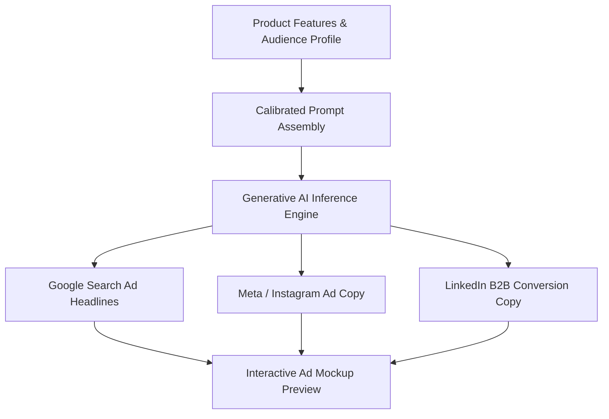

# AI Advertisement Copy and Campaign Asset Generator

> Generative AI marketing engine creating demographic-targeted ad headlines and copy variations.

[](https://github.com/sohailahmed-bsrh/ai-ads-maker)
[](https://sohail.devsil.com/projects.html)
[](https://sohail.devsil.com)

---

## Overview

Digital advertising campaigns require constant creative refresh and A/B variations that overwhelm marketing teams when drafted manually.

This project provides an end-to-end, reproducible implementation engineered to solve this challenge through verified data transformations, robust algorithms, and production-ready architecture.

---

## Key Features

- Automated copy generation across Google Ads, Meta Ads, and LinkedIn formats
- Demographic and tone calibration adjusting readability and conversion emphasis
- Visual banner card generator structuring asset dimensions for cross-platform ads
- Fast full-stack architecture with React/Vite frontend and Node.js backend

---

## System Architecture



---

## Technology Stack

| Technology | Version / Spec | Role in Architecture |
| :--- | :--- | :--- |
| **React & Vite** | `18.2+` | Dynamic marketing campaign preview dashboard |
| **Node.js & Express** | `18+` | API orchestrator and copy generation endpoints |
| **Python / Generative AI APIs** | `Latest` | Natural language generation and prompt templates |

---

## Repository Structure

```text
ai-ads-maker/
|-- backend/
|   |-- src/
|   `-- package.json
|-- frontend/
|   |-- src/
|   `-- package.json
|-- .env.example
|-- .gitignore
`-- README.md
```

---

## Installation and Execution

### Prerequisites
- Node.js 18+ / Python 3.10+
- Git version control

### Setup Instructions
1. Clone the repository:
```bash
git clone https://github.com/sohailahmed-bsrh/ai-ads-maker.git
cd ai-ads-maker
```

2. Configure environment and dependencies:
```bash
cd backend && npm install
cd ../frontend && npm install
npm run dev
```

---

## Interface and Verification
The system produces verifiable execution logs, prediction matrices, or interactive browser interfaces depending on the target mode. Verify operation by executing the commands specified above or inspecting the demonstration notebooks.

---

## Author and Contact
Developed by **Sohail Ahmed** — Full Stack AI Engineer & Machine Learning Specialist.
- **Portfolio:** [sohail.devsil.com](https://sohail.devsil.com)
- **GitHub:** [@sohailahmed-bsrh](https://github.com/sohailahmed-bsrh)
- **Email:** [sohail.bsrh@gmail.com](mailto:sohail.bsrh@gmail.com)
