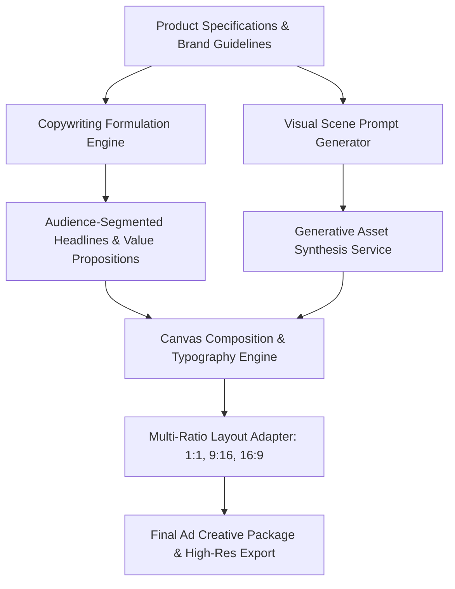

<div align="center">

<h1>Generative Advertisement Creation Pipeline</h1>


<p><strong>Generative System for Automated Ad Copywriting, Visual Synthesis, and Format Adaptation</strong></p>

<p>
  <a href="https://skillicons.dev"></a>
</p>

<p>
  <a href="#overview">Overview</a> &bull;
  <a href="#system-architecture">Architecture</a> &bull;
  <a href="#visual-showcase-gallery">Visual Gallery</a> &bull;
  <a href="#core-capabilities">Capabilities</a> &bull;
  <a href="#installation--setup">Installation</a> &bull;
  <a href="#author--contact-information">Author</a>
</p>

</div>

---
## Overview

AI Ads Maker is an automated marketing generation platform that transforms basic product inputs into structured, multi-channel advertising creatives. By coupling high-converting marketing copywriting templates with generative asset synthesis, the application generates targeted copy variants, product visuals, and formatted layouts across major advertising channels.

---

## Visual Showcase Gallery

<table width="100%" align="center">
  <tr>
    <td width="50%" align="center"><b>Campaign Ingestion Studio</b><br><sub>Product description, audience targeting, and tone configuration.</sub></td>
    <td width="50%" align="center"><b>Generative Copy & Visual Matrix</b><br><sub>Dynamic headline variants paired with synthesized product layouts.</sub></td>
  </tr>
  <tr>
    <td align="center"></td>
    <td align="center"></td>
  </tr>
  <tr>
    <td width="50%" align="center"><b>Multi-Platform Preview Canvas</b><br><sub>Visual inspection of 1:1, 9:16, and 16:9 responsive ad formats.</sub></td>
    <td width="50%" align="center"><b>Asset Export & Production Package</b><br><sub>Batch asset export ready for advertising platform deployment.</sub></td>
  </tr>
  <tr>
    <td align="center"></td>
    <td align="center"></td>
  </tr>
  <tr>
    <td width="50%" align="center"><b>Audience Segmentation Configurator</b><br><sub>Fine-tuning demographic and psychological target parameters.</sub></td>
    <td width="50%" align="center"><b>Creative Variation Matrix</b><br><sub>Side-by-side A/B testing review of generated ad variations.</sub></td>
  </tr>
  <tr>
    <td align="center"></td>
    <td align="center"></td>
  </tr>
  <tr>
    <td colspan="2" align="center"><b>Final High-Resolution Asset Download Hub</b><br><sub>ZIP packaging of images, copy snippets, and JSON manifests.</sub></td>
  </tr>
  <tr>
    <td colspan="2" align="center"></td>
  </tr>
</table>

---

## System Architecture



---

## Technology Stack

| Layer | Technologies |
| :--- | :--- |
| Frontend | React, TypeScript, Vite, Tailwind CSS |
| Backend Server | FastAPI, Python 3.10+, Uvicorn |
| Image Processing | Pillow, OpenCV |
| APIs | RESTful JSON Endpoints |

---

## Installation & Setup

```bash
# Clone the repository
git clone https://github.com/sohailahmed-bsrh/ai-ads-maker.git
cd ai-ads-maker

# Start backend
cd backend
pip install -r requirements.txt
python main.py

# Start frontend
cd ../frontend
npm install
npm run dev
```
---

## Author & Contact Information

<table width="100%" align="center">
  <tr>
    <td align="center" style="padding: 20px;">
      <h3>Sohail Ahmed</h3>
      <p><strong>Full-Stack Artificial Intelligence & Computer Vision Engineer</strong></p>
      <p>
        <a href="https://sohail.devsil.com"></a>
        <a href="https://github.com/sohailahmed-bsrh"></a>
        <a href="https://linkedin.com/in/sohail-ahmed-dev"></a>
        <a href="mailto:sohail.bsrh@gmail.com"></a>
      </p>
      <p><em>Available for technical roles in Artificial Intelligence, Computer Vision, and Full-Stack Engineering.</em></p>
      <hr style="border: 0; height: 1px; background: #30363d; margin: 15px 0;">
      <small>Repository: <code>sohailahmed-bsrh/ai-ads-maker</code> &bull; Distributed under the MIT License.</small>
    </td>
  </tr>
</table>
