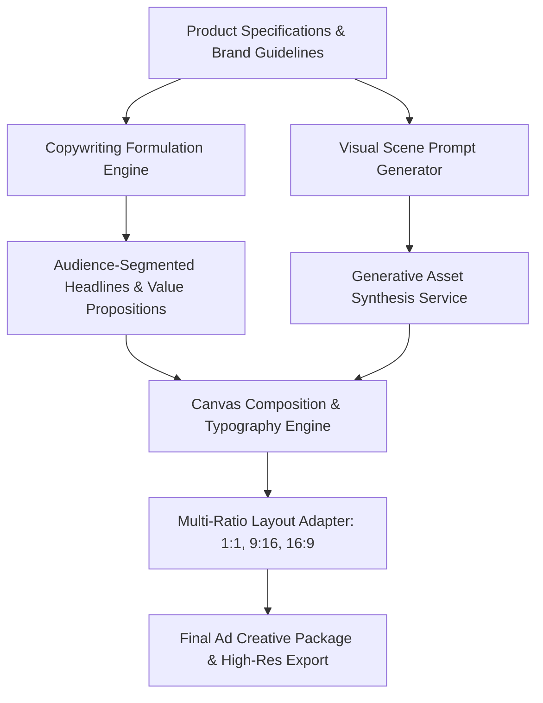

<div align="center">

<h1>Generative Advertisement Creation Pipeline</h1>


<p><strong>Generative System for Automated Ad Copywriting, Visual Synthesis, and Format Adaptation</strong></p>

<p>
  <a href="https://skillicons.dev"></a>
</p>

<p>
  <a href="#overview">Overview</a> &bull;
  <a href="#purpose--problem-statement">Purpose</a> &bull;
  <a href="#real-world-industry-applications">Use Cases</a> &bull;
  <a href="#step-by-step-engineering-walkthrough">How It Was Built</a> &bull;
  <a href="#system-architecture">Architecture</a> &bull;
  <a href="#visual-showcase-gallery">Visual Gallery</a> &bull;
  <a href="#technology-stack-matrix">Tech Stack</a> &bull;
  <a href="#installation--setup">Installation</a> &bull;
  <a href="#author--contact-information">Author</a>
</p>

</div>

---
## Overview

AI Ads Maker is an automated marketing generation platform that converts raw product descriptions into structured, multi-channel advertising creatives. By coupling high-converting marketing copywriting frameworks (AIDA, PAS) with generative visual synthesis, the system outputs targeted copy variants, product visual compositions, and formatted layouts across major advertising channels.

---

## Purpose & Problem Statement

### The Problem
Digital marketing agencies and direct-to-consumer (D2C) brands face the creative fatigue barrier: digital ad performance declines rapidly after 7-14 days on Meta, Google, and TikTok. Producing dozens of creative variations across multiple aspect ratios (1:1 square, 9:16 vertical stories, 16:9 widescreen banners) requires continuous design agency hours and high financial overhead.

### The Engineering Purpose
To build a programmatic ad generation pipeline that ingests a single product link or specification sheet, derives audience-segmented copywriting angles, generates high-contrast product background scenes, and renders production-ready ad packages across all major advertising aspect ratios.

---

## Real-World Industry Applications

- **Direct-to-Consumer (D2C) E-Commerce**: Rapid creative generation for Shopify brand owners testing dozens of ad hooks weekly.
- **Digital Performance Marketing Agencies**: Automated creative production for performance marketers managing multi-client ad budgets.
- **App & SaaS Product Launches**: Generating formatted feature announcement banners and conversion-optimized social assets.
- **Local Business Marketing**: Creating localized, branded promotion flyers and social ads with minimal technical effort.

---

## Step-by-Step Engineering Walkthrough (How It Was Built)

### Step 1: Product Ingestion & Feature Normalization
The ingestion service (`backend/src/services/upload.service.js`) accepts product imagery and raw specifications. Text inputs are parsed into core value propositions, target customer personas, key features, and price points.

### Step 2: Algorithmic Copywriting Generation
The copywriting service (`backend/src/services/script.service.js`) implements psychological advertising frameworks:
- **Attention-Interest-Desire-Action (AIDA)**
- **Problem-Agitate-Solution (PAS)**
- **Before-After-Bridge (BAB)**
The system outputs high-converting headlines, body text variants, and localized calls-to-action (CTAs).

### Step 3: Generative Visual Scene Synthesis & Composition
The visual module (`backend/src/services/video.service.js`) removes background clutter from product photos and places products into synthesized commercial environments (lifestyle settings, studio pedestals, luxury textures).

### Step 4: Multi-Ratio Layout Adaptation Engine
The composition engine computes typographical layouts across:
- **1:1 Square**: Instagram and Facebook In-Feed posts.
- **9:16 Vertical**: TikTok, Instagram Reels, and YouTube Shorts.
- **16:9 Landscape**: YouTube In-Stream ads and Google Display Network banners.
Font scaling, padding vectors, and contrast backgrounds are automatically calculated to ensure legibility across all viewport resolutions.

### Step 5: Batch Production Packaging & Export
The backend packages generated creatives into a structured export bundle containing high-resolution PNGs, video clips with voiceover audio, and an accompanying JSON metadata manifest ready for bulk upload into Meta Ads Manager.

---

## System Architecture



---

## Visual Showcase Gallery

<table width="100%" align="center">
  <tr>
    <td width="50%" align="center"><b>Campaign Ingestion Studio</b><br><sub>Product description, audience targeting, and tone configuration.</sub></td>
    <td width="50%" align="center"><b>Generative Copy & Visual Matrix</b><br><sub>Dynamic headline variants paired with synthesized product layouts.</sub></td>
  </tr>
  <tr>
    <td align="center"></td>
    <td align="center"></td>
  </tr>
  <tr>
    <td width="50%" align="center"><b>Multi-Platform Preview Canvas</b><br><sub>Visual inspection of 1:1, 9:16, and 16:9 responsive ad formats.</sub></td>
    <td width="50%" align="center"><b>Asset Export & Production Package</b><br><sub>Batch asset export ready for advertising platform deployment.</sub></td>
  </tr>
  <tr>
    <td align="center"></td>
    <td align="center"></td>
  </tr>
  <tr>
    <td width="50%" align="center"><b>Audience Segmentation Configurator</b><br><sub>Fine-tuning demographic and psychological target parameters.</sub></td>
    <td width="50%" align="center"><b>Creative Variation Matrix</b><br><sub>Side-by-side A/B testing review of generated ad variations.</sub></td>
  </tr>
  <tr>
    <td align="center"></td>
    <td align="center"></td>
  </tr>
  <tr>
    <td colspan="2" align="center"><b>Final High-Resolution Asset Download Hub</b><br><sub>ZIP packaging of images, copy snippets, and JSON manifests.</sub></td>
  </tr>
  <tr>
    <td colspan="2" align="center"></td>
  </tr>
</table>

---

## Technology Stack Matrix

| Layer | Technologies | Version / Role | Engineering Purpose |
| :--- | :--- | :--- | :--- |
| Backend Server | Node.js, Express | 20.x / 4.19+ | API routing, multipart file uploads, and generation queues |
| Media & Video Processing | FFmpeg, Fluent-FFmpeg | Latest | Audio track concatenation, video rendering, and aspect resizing |
| Frontend Application | React, Vite, Tailwind CSS | 18.2 / 5.0+ | Visual ad customizer, canvas previews, and parameter controls |
| Image Processing | Sharp, Canvas | Latest | Pixel manipulation, product background compositing, and font rendering |

---

## Installation & Setup

```bash
# Clone the repository
git clone https://github.com/sohailahmed-bsrh/ai-ads-maker.git
cd ai-ads-maker

# Start backend server
cd backend
npm install
npm start

# Start frontend in another terminal
cd ../frontend
npm install
npm run dev
```
---

## Author & Contact Information

<table width="100%" align="center">
  <tr>
    <td align="center" style="padding: 20px;">
      <h3>Sohail Ahmed</h3>
      <p><strong>Full-Stack Artificial Intelligence & Computer Vision Engineer</strong></p>
      <p>
        <a href="https://sohail.devsil.com"></a>
        <a href="https://github.com/sohailahmed-bsrh"></a>
        <a href="https://linkedin.com/in/sohail-ahmed-dev"></a>
        <a href="mailto:sohail.bsrh@gmail.com"></a>
      </p>
      <p><em>Available for technical roles in Artificial Intelligence, Computer Vision, and Full-Stack Engineering.</em></p>
      <hr style="border: 0; height: 1px; background: #30363d; margin: 15px 0;">
      <small>Repository: <code>sohailahmed-bsrh/ai-ads-maker</code> &bull; Distributed under the MIT License.</small>
    </td>
  </tr>
</table>
